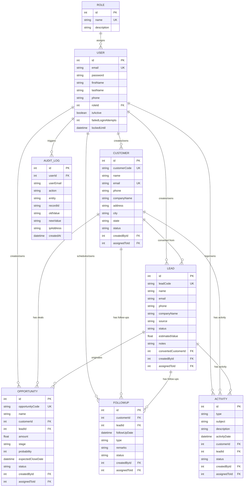

# 🗄 ACXIOMCRM Database Architecture & Design

This document describes the relational database design for **ACXIOMCRM**, implemented using **PostgreSQL** with **Prisma ORM**.

---

## 📊 Entity Relationship (ER) Diagram

---

## 🗃 Table Schema Breakdown

### 1. `roles` Table
| Column | Type | Constraints | Description |
|---|---|---|---|
| `id` | `INT` | Primary Key, Auto-increment | Role identifier |
| `name` | `VARCHAR(50)` | Unique, Not Null | `ADMIN`, `MANAGER`, `SALES_EXECUTIVE` |
| `description` | `TEXT` | Nullable | Role access description |
| `createdAt` | `TIMESTAMP` | Default Now() | Creation timestamp |
| `updatedAt` | `TIMESTAMP` | Auto-updated | Modification timestamp |

---

### 2. `users` Table
| Column | Type | Constraints | Description |
|---|---|---|---|
| `id` | `INT` | Primary Key, Auto-increment | User identifier |
| `email` | `VARCHAR(255)` | Unique, Not Null | Work email (login username) |
| `password` | `VARCHAR(255)` | Not Null | bcrypt salted password hash (cost 10) |
| `firstName` | `VARCHAR(100)` | Not Null | User's first name |
| `lastName` | `VARCHAR(100)` | Not Null | User's last name |
| `phone` | `VARCHAR(50)` | Nullable | Contact number |
| `roleId` | `INT` | Foreign Key (`roles.id`) | Assigned role reference |
| `isActive` | `BOOLEAN` | Default `true` | Account active state |
| `failedLoginAttempts` | `INT` | Default `0` | Lockout counter (locks after 5 attempts) |
| `lockedUntil` | `TIMESTAMP` | Nullable | Lockout expiration time (15 mins) |

---

### 3. `customers` Table
| Column | Type | Constraints | Description |
|---|---|---|---|
| `id` | `INT` | Primary Key, Auto-increment | Internal identifier |
| `customerCode` | `VARCHAR(50)` | Unique, Not Null | Sequential code e.g. `CUST-0001` |
| `name` | `VARCHAR(255)` | Not Null | Primary contact / account name |
| `email` | `VARCHAR(255)` | Unique, Not Null | Customer billing / main email |
| `phone` | `VARCHAR(50)` | Not Null | Contact phone number |
| `companyName` | `VARCHAR(255)` | Not Null | Company or business name |
| `address` | `TEXT` | Nullable | Street address |
| `city` | `VARCHAR(100)` | Nullable | City location |
| `state` | `VARCHAR(100)` | Nullable | State / Region |
| `status` | `VARCHAR(50)` | Default `'ACTIVE'` | `'ACTIVE'`, `'INACTIVE'` |
| `createdById` | `INT` | Foreign Key (`users.id`) | Creator user |
| `assignedToId` | `INT` | Foreign Key (`users.id`), Nullable | Account owner representative |

**Indexes**: `[email]`, `[status]`, `[assignedToId]`

---

### 4. `leads` Table
| Column | Type | Constraints | Description |
|---|---|---|---|
| `id` | `INT` | Primary Key, Auto-increment | Lead identifier |
| `leadCode` | `VARCHAR(50)` | Unique, Not Null | Sequential code e.g. `LEAD-0001` |
| `name` | `VARCHAR(255)` | Not Null | Prospective contact name |
| `email` | `VARCHAR(255)` | Not Null | Lead email |
| `phone` | `VARCHAR(50)` | Not Null | Lead phone number |
| `companyName` | `VARCHAR(255)` | Not Null | Lead organization name |
| `source` | `VARCHAR(50)` | Default `'WEBSITE'` | `WEBSITE`, `REFERRAL`, `COLD_CALL`, `EXHIBITION`, `SOCIAL_MEDIA`, `OTHER` |
| `status` | `VARCHAR(50)` | Default `'NEW'` | `NEW`, `CONTACTED`, `QUALIFIED`, `UNQUALIFIED`, `CONVERTED`, `LOST` |
| `estimatedValue`| `FLOAT` | Default `0.0` | Projected deal potential in USD |
| `notes` | `TEXT` | Nullable | Discovery notes & criteria |
| `convertedCustomerId` | `INT` | Foreign Key (`customers.id`), Nullable | Linked Customer if converted |
| `createdById` | `INT` | Foreign Key (`users.id`) | Lead creator |
| `assignedToId` | `INT` | Foreign Key (`users.id`), Nullable | Assigned Sales Rep |

**Indexes**: `[email]`, `[status]`, `[assignedToId]`

---

### 5. `opportunities` Table
| Column | Type | Constraints | Description |
|---|---|---|---|
| `id` | `INT` | Primary Key, Auto-increment | Deal identifier |
| `opportunityCode` | `VARCHAR(50)` | Unique, Not Null | Code e.g. `OPP-0001` |
| `name` | `VARCHAR(255)` | Not Null | Deal / project name |
| `customerId` | `INT` | Foreign Key (`customers.id`, `ON DELETE CASCADE`) | Required client account |
| `leadId` | `INT` | Foreign Key (`leads.id`, `ON DELETE SET NULL`), Nullable | Original lead (if converted) |
| `amount` | `FLOAT` | Not Null, Check > 0 | Contract / deal amount |
| `stage` | `VARCHAR(50)` | Default `'QUALIFICATION'` | `QUALIFICATION`, `PROPOSAL`, `NEGOTIATION`, `WON`, `LOST` |
| `probability` | `INT` | Default `10`, Check `0 <= prob <= 100` | Percentage likelihood |
| `expectedCloseDate` | `TIMESTAMP` | Not Null | Projected closing target |
| `status` | `VARCHAR(50)` | Default `'OPEN'` | `OPEN`, `WON`, `LOST` |
| `notes` | `TEXT` | Nullable | Commercial terms / notes |
| `createdById` | `INT` | Foreign Key (`users.id`) | Creator |
| `assignedToId` | `INT` | Foreign Key (`users.id`), Nullable | Deal executive owner |

**Indexes**: `[stage]`, `[status]`, `[customerId]`, `[assignedToId]`

---

### 6. `follow_ups` Table
| Column | Type | Constraints | Description |
|---|---|---|---|
| `id` | `INT` | Primary Key, Auto-increment | Follow-up identifier |
| `customerId` | `INT` | Foreign Key (`customers.id`, `ON DELETE CASCADE`), Nullable | Linked customer |
| `leadId` | `INT` | Foreign Key (`leads.id`, `ON DELETE CASCADE`), Nullable | Linked lead |
| `followUpDate` | `TIMESTAMP` | Not Null | Scheduled time |
| `type` | `VARCHAR(50)` | Default `'CALL'` | `CALL`, `MEETING`, `EMAIL`, `TASK` |
| `remarks` | `TEXT` | Not Null | Agenda & notes |
| `status` | `VARCHAR(50)` | Default `'PLANNED'` | `PLANNED`, `COMPLETED`, `MISSED`, `CANCELLED` |
| `createdById` | `INT` | Foreign Key (`users.id`) | Creator |
| `assignedToId` | `INT` | Foreign Key (`users.id`), Nullable | Assigned assignee |

**Indexes**: `[followUpDate]`, `[status]`, `[assignedToId]`

---

### 7. `activities` Table
| Column | Type | Constraints | Description |
|---|---|---|---|
| `id` | `INT` | Primary Key, Auto-increment | Activity identifier |
| `type` | `VARCHAR(50)` | Default `'CALL'` | `CALL`, `MEETING`, `EMAIL`, `TASK` |
| `subject` | `VARCHAR(255)` | Not Null | Summary line |
| `description` | `TEXT` | Nullable | In-depth notes |
| `activityDate` | `TIMESTAMP` | Default Now() | Date of interaction |
| `customerId` | `INT` | Foreign Key (`customers.id`, `ON DELETE CASCADE`), Nullable | Associated customer |
| `leadId` | `INT` | Foreign Key (`leads.id`, `ON DELETE CASCADE`), Nullable | Associated lead |
| `status` | `VARCHAR(50)` | Default `'COMPLETED'` | Status of task |
| `createdById` | `INT` | Foreign Key (`users.id`) | Creator |
| `assignedToId` | `INT` | Foreign Key (`users.id`), Nullable | Logged user |

---

### 8. `audit_logs` Table
| Column | Type | Constraints | Description |
|---|---|---|---|
| `id` | `INT` | Primary Key, Auto-increment | Log identifier |
| `userId` | `INT` | Foreign Key (`users.id`, `ON DELETE SET NULL`), Nullable | Triggering user |
| `userEmail` | `VARCHAR(255)` | Not Null | Email snapshot at time of event |
| `action` | `VARCHAR(50)` | Not Null | `LOGIN`, `FAILED_LOGIN`, `CREATE`, `UPDATE`, `DELETE`, `CONVERT_LEAD`, `SECURITY_EVENT` |
| `entity` | `VARCHAR(50)` | Not Null | `AUTH`, `USER`, `CUSTOMER`, `LEAD`, `OPPORTUNITY`, `FOLLOWUP`, `ACTIVITY` |
| `recordId` | `VARCHAR(50)` | Nullable | Target record ID |
| `oldValue` | `TEXT` (JSON) | Nullable | Sanitized pre-modification JSON state |
| `newValue` | `TEXT` (JSON) | Nullable | Sanitized post-modification JSON state |
| `ipAddress` | `VARCHAR(50)` | Default `'127.0.0.1'` | Client IPv4/IPv6 address |
| `createdAt` | `TIMESTAMP` | Default Now() | Event timestamp |

**Indexes**: `[action]`, `[entity]`, `[userId]`, `[createdAt]`

---

## 🎯 Database Normalization (3NF)

1. **First Normal Form (1NF)**: Every table has an atomic primary key (`id`), and all attribute fields contain atomic scalar values (no multi-valued comma strings).
2. **Second Normal Form (2NF)**: All non-key attributes are fully functionally dependent on the entire primary key.
3. **Third Normal Form (3NF)**: No transitive dependencies exist. For example, role details are stored in `roles` rather than repeated across individual `users` records.
